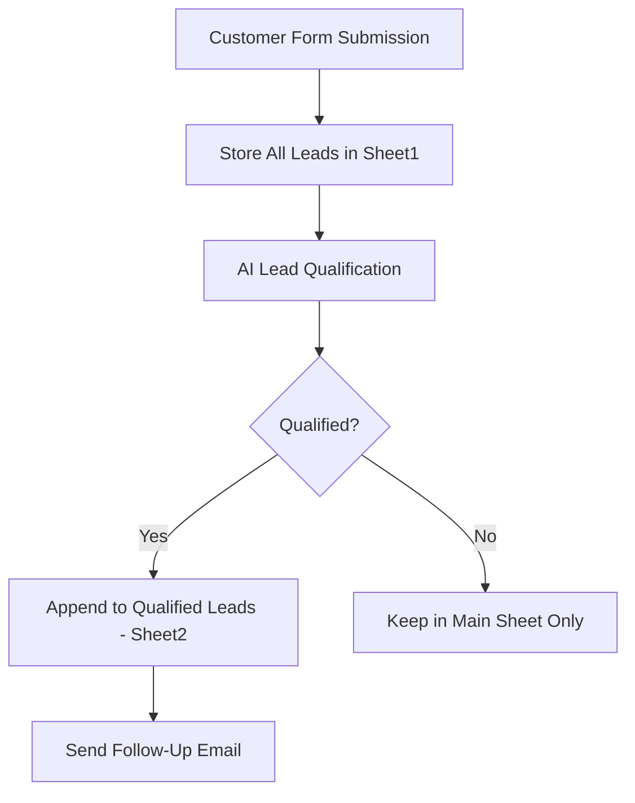

# 🤖 AI-Powered Lead Qualification Automation

An AI-powered lead management workflow built with **n8n, Google Gemini, Google Sheets, and Gmail**. The system automatically collects customer inquiries, evaluates leads based on budget and purchase timeline, stores qualified leads separately, and prepares personalized follow-up emails.

## ✨ Overview

Managing incoming leads manually can be time-consuming. This project automates the lead qualification process by connecting form submissions to AI-based evaluation and Google Sheets.

Every lead is recorded in a central spreadsheet, while qualified leads are intended to be stored separately for easier follow-up.

## 🚀 Features

- **Automated Lead Collection** — Capture customer information through an n8n form trigger.
- **AI-Powered Qualification** — Use Google Gemini to evaluate budget and purchase timeline.
- **Centralized Lead Storage** — Store every submitted lead in Google Sheets.
- **Qualified Lead Management** — Maintain a separate sheet for qualified leads.
- **Automated Email Follow-Up** — Integrate Gmail to send follow-up emails to eligible leads.
- **Workflow Automation** — Connect data collection, qualification, storage, and communication in one workflow.
- **Customizable Rules** — Adjust qualification thresholds to match business requirements.

## 🧠 Lead Qualification Logic

The current qualification criteria are:

| Parameter | Qualification rule |
|---|---|
| Budget | ₹3,00,000 or more |
| Purchase timeline | Within 90 days |
| Final status | Both conditions must pass |

A lead is marked **QUALIFIED** only when both conditions are satisfied. If either condition fails or the information is unclear, the lead should be marked **NOT QUALIFIED**.

Examples:

| Budget | Purchase timeline | Expected result |
|---|---|---|
| ₹5,00,000 | Within 30 days | QUALIFIED |
| ₹3,00,000 | Within 90 days | QUALIFIED |
| ₹50,000 | Within 30 days | NOT QUALIFIED |
| ₹5,00,000 | In 6 months | NOT QUALIFIED |

## 🛠️ Technology Stack

- [n8n](https://n8n.io/) — Workflow automation
- [Google Gemini](https://ai.google.dev/) — AI-powered lead evaluation
- [Google Sheets](https://sheets.google.com/) — Lead storage and management
- [Gmail](https://mail.google.com/) — Email integration
- [GitHub](https://github.com/) — Version control and project documentation

## 🔄 Workflow Architecture

1. **Form Submission:** A customer submits their contact details, budget, and expected purchase timeline.
2. **Store All Leads:** The submission is appended to the main Google Sheet.
3. **AI Qualification:** Google Gemini evaluates the lead using the defined qualification criteria.
4. **Qualified Lead Processing:** Qualified leads are passed to the Google Sheets append operation for the dedicated qualified-lead sheet.
5. **Email Follow-Up:** The workflow prepares and sends an email to eligible leads through Gmail, subject to successful configuration and execution.

## 📋 Lead Data Fields

The workflow can manage fields such as:

- Customer name
- Email address
- Phone number
- Budget
- Expected purchase timeline
- Submission date and time
- Qualification status and reason

The exact field names depend on the form and Google Sheets column configuration.

## ⚙️ Setup and Configuration

### Prerequisites

Before importing or recreating the workflow, ensure you have:

- An n8n instance, local or hosted
- A Google account
- A Google Cloud project configured for the required OAuth credentials
- Access to Google Sheets and Gmail
- A Google Gemini API key or supported Gemini credential

### Setup Steps

1. Create a Google spreadsheet with two tabs:
   - `Sheet1` — All Leads
   - `Sheet2` — Qualified Leads
2. Configure the n8n form trigger and map the submitted fields.
3. Connect the Google Sheets credentials.
4. Configure the Gemini model and qualification instructions.
5. Configure the Google Sheets append operation for qualified leads.
6. Connect Gmail and map the recipient, subject, and message fields.
7. Test qualified and unqualified submissions before activating the workflow.

### Environment and Credentials

Configure credentials through n8n's credential manager. Do not commit API keys, OAuth client secrets, passwords, or customer data to GitHub.

For local development, n8n can be run using Docker. Follow the official [n8n documentation](https://docs.n8n.io/).

## 🧪 Testing

Test at least the following cases before using the workflow with real customers:

- A lead meeting both qualification criteria.
- A lead with a budget below the threshold.
- A lead with a purchase timeline beyond 90 days.
- A lead with missing or ambiguous information.
- A lead with an invalid email address.
- A duplicate qualified lead.

Verify that every submission reaches Sheet1, only eligible leads reach Sheet2, and email execution succeeds only for eligible leads with valid email addresses.

## 🔐 Security Considerations

- Keep Google and Gemini credentials private.
- Avoid publishing real customer records.
- Review exported n8n workflow JSON before committing it.
- Use the minimum permissions required for connected accounts.
- Test OAuth configuration and email delivery before deployment.
- Do not treat AI-generated qualification alone as a security or compliance guarantee.

## 🗺️ Future Improvements

- Add a dashboard for lead conversion analytics.
- Introduce duplicate detection and retry handling.
- Add lead scoring based on additional business criteria.
- Send notifications when high-priority leads arrive.
- Add error logging and execution monitoring.
- Deploy the workflow on a reliable hosted n8n instance.

## 🤝 Contributing

Suggestions and improvements are welcome. Fork the repository, create a feature branch, and submit a pull request.

## 📄 License

Choose a license before distributing the project publicly. For example, the MIT License may be suitable if you want others to reuse and modify your code.

---

**Built with n8n, Google Gemini, Google Sheets, and Gmail.**
